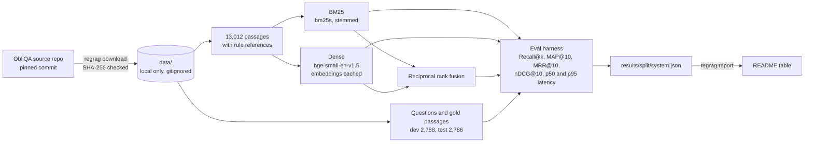

# RegRAG UAE

[](https://github.com/talalz94/regrag-uae/actions/workflows/ci.yml)

Cited answers over ADGM financial regulations, built with the evals first. This first slice answers the question everything else depends on: given a compliance question, does the system find the rule passages that answer it?

It runs on [ObliQA](https://github.com/RegNLP/ObliQADataset), a public benchmark of 27,869 questions over 40 rulebooks and guidance documents from Abu Dhabi Global Market (ADGM), the financial free zone in Abu Dhabi. Everything runs on a laptop CPU with no API keys.

**Why this repo exists.** I built and ran a RAG assistant in production on FastAPI and Kubernetes. That system is private, so this is a public rebuild of the same problem shape, written from scratch on open data. No employer or client code, data or details are in here.

## Results

<!-- results:start -->
<!-- results:end -->

**Published baselines on the same test split** (RIRAG paper, [arXiv:2409.05677](https://arxiv.org/abs/2409.05677), Table 4, passage only setting). These are quoted, not reproduced:

| System | Recall@10 | MAP@10 |
|---|---:|---:|
| BM25 | 76.1 | 62.4 |
| DRAGON+ | 74.3 | 58.1 |
| SPLADEv2 | 75.7 | 60.4 |
| ColBERTv2 | 77.7 | 63.0 |
| NV-Embed-v2 | 78.3 | 63.5 |
| BGE-EN-ICL, 5 shot | 79.3 | 64.4 |

The paper does not say which tool computed its metrics or exactly how gold passages were matched, so read gaps of about a point as setup noise. The metric code here follows trec_eval and is unit tested ([tests/test_metrics.py](tests/test_metrics.py)).

## Quickstart

You need [uv](https://docs.astral.sh/uv/). It installs Python 3.12 and the exact versions in `uv.lock` (CPU only, on Windows, macOS or Linux).

```bash
git clone https://github.com/talalz94/regrag-uae.git
cd regrag-uae
uv run poe quickstart
```

`quickstart` downloads ObliQA from its source repo once you accept its notice, runs every default system on the dev and test splits, and rewrites the results above. Then ask it something:

```bash
uv run regrag search "How often must a custodian reconcile client virtual assets?"
```

Other tasks: `uv run poe --help`. The two slow bge-base ablations run with `uv run regrag reproduce --systems dense-base hybrid-base`.

## How it works



- **Corpus.** Every non empty passage in the 40 structured documents. Each keeps its document number and rule reference, which become the citation, for example `Doc 11, 1.1.2`.
- **BM25.** Lucene style BM25 from `bm25s` over lowercased, stemmed tokens with English stopwords removed. Rule numbers like `11.2.1` stay one token, because questions often cite a rule by number.
- **Dense.** `BAAI/bge-small-en-v1.5` (33M parameters, MIT) at a pinned revision, with the BGE query instruction. Exact cosine search over all passages. Embeddings are cached under `data/cache/`, keyed by model revision and corpus contents.
- **Hybrid.** Reciprocal rank fusion of the top 100 from each retriever, with the standard constant k = 60. Nothing is tuned.
- **LLM backend, for the next slice.** [src/regrag/llm.py](src/regrag/llm.py) speaks the chat completions API used by OpenAI, Azure OpenAI in Azure AI Foundry, Ollama and vLLM. The provider and keys come only from environment variables (see [.env.example](.env.example)). Nothing in this slice calls it.

### Choices I rejected

- **A vector database** (FAISS, pgvector, Azure AI Search). At 13,012 passages, exact search is one matrix product. An approximate index would add a service and some recall loss for no gain at this size. It comes back if the corpus grows by a lot.
- **Splitting into fixed size windows.** ObliQA's passages are already rule level units and the gold labels sit at that level. New chunks would break the link to the labels and to the published baselines. Adding each passage's parent headings is the next ablation instead.
- **LangChain or LlamaIndex.** The retrieval code is a few hundred lines of plain Python, which keeps every step of the eval easy to read and test.
- **Tuned score fusion.** RRF needs no score scaling and has one standard constant, so nothing gets fitted to the test split. A weighted blend tuned on dev is a later experiment.
- **7B embedding models** (NV-Embed-v2, BGE-EN-ICL). They top the published table but are not practical on a laptop CPU. Their published scores are listed above for comparison.

## Eval method

- **Splits.** The official ObliQA dev (2,788 questions) and test (2,786) files. Nothing is tuned on either.
- **Gold passages.** A question's relevant passages are the ones it was generated from, 1 to 6 per question. They are matched to the corpus by document number and rule reference. 17 references are shared by more than one passage; those ties are broken by exact passage text. Every gold reference in every split resolves to exactly one passage.
- **Metrics.** Binary relevance, as in trec_eval, averaged over questions. Recall@k is the share of a question's gold passages found in the top k. MAP@10 is average precision cut at 10, divided by the number of gold passages. MRR@10 is one over the rank of the first gold passage in the top 10. nDCG@10 uses the usual log2 discount. Recall@10 is the shared task's main metric.
- **Latency.** Each question is searched on its own and timed inside the retriever, including query encoding and fusion, after 3 warmup queries. p50 and p95 are over every question in the split.
- **Cost.** All systems here run locally, so the API cost is $0.00 per 1,000 queries. The column stays so the answer slice can fill it with real token costs.
- **Provenance.** `regrag reproduce` writes one JSON per system and split to `results/`, with the hardware, package versions and dataset commit. `regrag report` renders the table from those files and nothing else.

## Data and model

- [Data card](docs/DATA_CARD.md): where ObliQA comes from, how it was made, its quirks and its license position.
- [Model card](docs/MODEL_CARD.md): components, intended use, out of scope uses and risks.
- ObliQA has no license file, so this repo does not include it or anything derived from it except aggregate metrics. Tests and CI use a tiny made up rulebook in `tests/fixtures/`.

## Limitations

- The questions were written by GPT-4 from the gold passages, so they share wording with them. That favours lexical matching and probably overstates how well any of these systems would do on questions from real compliance officers.
- The labels are incomplete. Only the passages a question was generated from count as relevant, so a correct passage from elsewhere in the rulebook counts as a miss. In the authors' expert review of 991 questions, 3.5% of gold passages were judged irrelevant and 9.1% relevant but not a direct answer.
- The rulebooks are a snapshot from around 2024. This is not a source of current law.
- English only. Arabic questions are untested.
- Latency was measured on one laptop CPU. Expect different numbers on other machines.
- Retrieval only. No answers are generated yet, so nothing here measures answer quality.

## Next

1. Cited answers that refuse when retrieval is weak, scored with [RePASs](https://github.com/RegNLP/RePASs) (the shared task's answer metric) and a 100 question set I label by hand, with LLM judge agreement against my labels reported.
2. A reranker and parent heading context as ablations against this baseline, plus a regression gate in CI.
3. OpenTelemetry tracing (Langfuse or Phoenix), cost per 1,000 requests with a real model, and a FastAPI service with a capped demo.
4. An Azure AI Foundry variant: Azure OpenAI for answers through `REGRAG_LLM_PROVIDER=azure`, and Azure AI Search as a retriever to compare against the local hybrid.

## Layout

```
src/regrag/    data loading, retrievers, metrics, eval harness, report, CLI, LLM backend
tests/         unit tests on a tiny synthetic rulebook (CI never downloads ObliQA)
results/       one JSON per system and split, written by `regrag reproduce`
docs/          data card and model card
```

## Credits and license

ObliQA and the RIRAG baselines are by Tuba Gokhan, Kexin Wang, Iryna Gurevych and Ted Briscoe ([paper](https://arxiv.org/abs/2409.05677), [data](https://github.com/RegNLP/ObliQADataset)). The embedding models are by BAAI and MIT licensed. The code in this repo is MIT licensed; that license does not cover the dataset.
